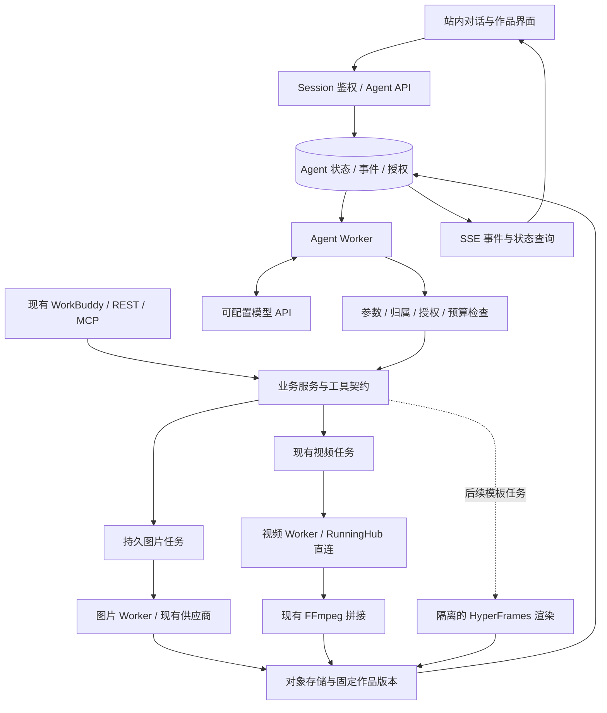
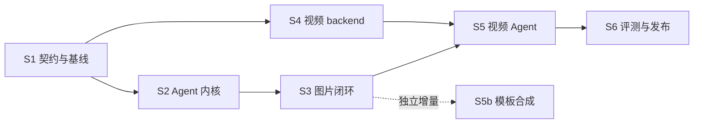

# Lampstage 电商图片与视频 Agent 开发方案

> 面向后续执行者：按本文阶段拆分实施 SPEC；可使用 `superpowers:subagent-driven-development` 或 `superpowers:executing-plans` 逐项执行。独立模块可以并行，同一文件不得由多个执行者同时修改。用户于 2026-10-16 已授权统筹分派并推进本地实施，具体批次与文件范围以 `tasks/LAMP-AGENT-CONTROL.md` 及各实施 SPEC 为准；生产迁移、真实付费生成与部署尚未授权。

**目标：** 商家在 Lampstage 网站上传商品素材、描述需求，由自有 Agent 制作方案、调用图片/视频工具、展示作品，并根据反馈局部修改。

**架构：** 保留现有 Next.js、Prisma/PostgreSQL、对象存储、图片供应商和视频 Worker；新增自有 Agent 运行层、持久化步骤与作品反馈界面。选择性参考或抽取 OpenDesign 模块，逐步移除新视频任务对 Hypit 的依赖。

**技术栈：** Next.js 14 / React 18 / TypeScript / Prisma / PostgreSQL；现有 S3 兼容存储；独立 Node Worker；现有图片服务、拟直连 RunningHub、现有 FFmpeg；HyperFrames 作为后续模板合成增量。

**状态：** 本地实施中；2026-10-16 从源码只读盘点转入独立模块 Wave 1，已分派运行内核、图片任务和视频后端三个专项对话。本文其余“本轮未执行”表述记录最初方案盘点的范围；最新代码与验证状态见控制单，不据此推断已接生产链路。

**2026-10-17 方向补充：** 用户现已提出基于官方DeepSeek Harness的桌面形态，并明确目标为可分发给商家安装的产品。CONTROL47记录W5F/W5G联合验收；CONTROL48–49记录桌面方向与待审阅方案 `docs/superpowers/specs/2026-10-17-lampstage-desktop-harness-design.md`。本文站内网页架构作为既有实施依据保留，不能据此继续自动派发新的网页接线任务；桌面方案确认并形成准确实施规格后再开工。

---

## 1. 推荐决策与首版范围

### 1.1 三条路线的取舍

| 路线 | 收益 | 代价 | 建议 |
|---|---|---|---|
| 在现有 Lampstage 上增加自有 Agent | 沿用用户、资产、额度、图片与视频能力；对话体验和业务规则由自己掌控 | 需建设运行状态、队列、工具策略和作品反馈 | **采用** |
| 整体 fork OpenDesign，再接电商后端 | 较快得到完整设计工作台 | 要适配本地 daemon/目录/进程模型，并维护大量无关功能；与现有后端重复 | 作为独立实验选项，不作为主线 |
| 继续只扩展 WorkBuddy Expert | 最少开发，能继续验证创作流程 | 商家入口、会话执行和交互能力依赖外部宿主 | 保留兼容入口，作为对照与回退渠道 |

首版按“站内自有对话 + 现有 WorkBuddy API/MCP 继续可用”设计。当前 `PROJECT_CARD.md` 的 WorkBuddy 主入口是现状；站内 Agent 是本方案提出的新产品方向，实施阶段再更新产品定义。

### 1.2 首版交付的两个闭环

1. **图片：** 上传商品参考图 → 识别可确认的商品事实 → 制作图片方案 → 在已授权范围内生成 → 查看候选 → 指定某张进行修改 → 下载。
2. **视频：** 上传参考视频和商品素材 → 制作分镜计划 → 查看素材、动作窗口与费用范围 → 生成片段 → 逐段检查/选择 → 合成并完整播放 → 下载。

首版限制：

- 图片保留现有 `nano_banana_21`、`image_25`，仅开放当前代码验证通过的 **1:1**；1–6 张参考图、每任务 1–4 张输出按现有契约执行。产品策略上限不等于供应商实测上限。
- 视频第一批接现有参考视频工作流；段长、参考数量和片段数均由当前 capabilities 和服务端校验决定，不预先承诺任意时长/分辨率。
- 商品事实、品牌风格、人物版本、场景参考分别保存；修改场景不能默认修改商品颜色、结构、Logo 或人物身份。
- 成本授权可覆盖一个明确的计划和有限重试次数；在授权仍有效时复用，避免每一步反复确认。
- 图像局部修改先采用现有参考图重生成方式，明确“局部修改意图不保证像素级不变”；蒙版编辑、精确排版属于后续独立能力。
- 第一版不开放任意 shell、宿主文件访问、商家自定义代码插件，也不做团队协作、技能市场或桌面应用。

## 2. 已核实的现有基础与缺口

工作根：`C:/Users/boss0/Desktop/05-项目文件夹/网站制作/lamp-saas-mvp`。

本地 Git HEAD：`d1200f16d35816ef2e5a5eef42f221d1586898c4`。工作区存在大量未提交和未跟踪内容；以下判断基于当时磁盘文件，不代表全部内容已提交、部署或通过真实生成验收。后续开工必须重新记录基线。

| 能力 | 实际代码位置 | 复用方式 / 缺口 |
|---|---|---|
| 站内登录与 API Key | `apps/web/lib/auth.ts`、`public-api.ts`、`api-key.ts`、`mcp-auth.ts` | 浏览器用 session，公开 API 用个人密钥；新增共同服务上下文，不能让模型指定用户身份 |
| 工具目录与协议 | `apps/web/lib/mcp-tools.ts` | 已有图片、视频、素材、人物和模板工具；它是工具执行入口，不是自有 LLM 决策循环 |
| 图片素材 | `apps/web/lib/assets/image-content.ts`、`app/api/v1/assets/route.ts` | `uploadImageContent()`、格式/体积校验、用户范围去重可复用 |
| 视频素材 | `apps/web/app/api/v1/video-assets/route.ts`、`lib/video/storage.ts` | multipart、文件签名检查和私有存储可复用；站内 session 路由需共享业务服务 |
| 上传入口差异 | `apps/web/lib/mcp-download.ts`、`mcp-tools.ts` | MCP `upload_asset` 接公网 URL；本地文件应走 multipart，不能把磁盘路径伪装为 URL |
| 图片任务 | `apps/web/lib/generation.ts`、`app/api/v1/image-jobs/route.ts` | `createAndRunGenerationJob()` 仍在请求中等待完整生成；需拆出持久队列、执行和恢复 |
| 图片模型和用量 | `apps/web/lib/image-models.ts`、`lib/providers/` | 固定 job 的模型/供应商，复用现有请求构造和 usage 提取；首版不做自动换模型 |
| 品牌体系 | `apps/web/lib/brand-kit.ts`、`brand-kits/` | 已有解析/校验/注入；API、MCP 和站内任务尚缺 C30 所列的显式贯通 |
| 图片额度 | `apps/web/lib/credits.ts`、`generation.ts` | 沿用业务 job 扣费与退款；AgentStep 不再重复扣图片额度。任务创建目前缺请求幂等保护 |
| 视频任务与恢复 | `apps/web/lib/video/repository.ts`、`processor.ts`、`sixref-processor.ts`、`scripts/video-worker.ts` | 复用租约、状态、permit、恢复及未知提交处理；保留现有三个 generation mode 的兼容语义 |
| 视频审阅 | `apps/web/lib/video/consent.ts`、`review-token.ts`、`candidate-review.ts` | 复用审阅快照绑定；不能由模型自己填写“用户已同意”来跳过确认 |
| 视频拼接 | `apps/web/lib/video/media.ts:118` 的 `assembleVideo()` | **当前已用我方 FFmpeg 拼接**，输出校验已有实现；不需要先引入 HyperFrames 才能去 Hypit 化 |
| 人物、模板与交付 | `apps/web/lib/characters/`、`lib/video/template-service.ts`、`delivery-service.ts` | 继续使用固定版本和账户归属；模板复用不继承旧任务的费用授权 |
| 账单与日志 | `apps/web/lib/billing/usage.ts`、`providers/provider-usage.ts`、`tool-log.ts` | 已有部分 token 用量；视频实际费用仍可能是 null。ToolCallLog 不能充当可靠任务日志或账本 |
| 电商知识与流程 | `workbuddy-expert/lampstage-creative-expert/agents/`、`skills/` | 商品理解、文案、作图、视频、人物库规则可迁入自有上下文；替换宿主特有操作方式 |

新增重点不是重复实现生图函数，而是：持续执行与恢复、统一业务工具、可核验授权、版本反馈，以及不会重复花费的任务调度。

## 3. OpenDesign 代码复用清单

固定参考版本：[`78d5637cb49da07e81314d1544b5fc6d37c95084`](https://github.com/nexu-io/open-design/tree/78d5637cb49da07e81314d1544b5fc6d37c95084)。开工不直接追随 `main`；更新上游版本须重做差异与许可核查。

分类：**A = 小范围直接抽取候选；B = 有实质改造才能复用；C = 参考设计、自研实现。** “候选”表示源码边界适合，尚未完成目标系统编译、依赖与契约验证。

| 分类 / 优先级 | 上游文件 | 可以复用什么 | 目标位置与必要变化 |
|---|---|---|---|
| A / 按需 | [`media-adapters/types.ts`](https://github.com/nexu-io/open-design/blob/78d5637cb49da07e81314d1544b5fc6d37c95084/apps/daemon/src/media-adapters/types.ts) | 无网络、鉴权和文件系统依赖的媒体能力类型 | 候选放入 `apps/web/lib/media-capabilities/types.ts`；只抽取需要的类型，避免与现有 image/video 契约重复 |
| B / 按需 | [`media-adapters/capabilities.ts`](https://github.com/nexu-io/open-design/blob/78d5637cb49da07e81314d1544b5fc6d37c95084/apps/daemon/src/media-adapters/capabilities.ts) | Map 注册表和能力查询 | 候选 `lib/media-capabilities/registry.ts`；去掉固定剥离 `aihubmix-` 的归一化，使用我方明确的模型 ID；能力值取自我方验证 |
| B / 暂缓 | [`media-adapters/video.ts`](https://github.com/nexu-io/open-design/blob/78d5637cb49da07e81314d1544b5fc6d37c95084/apps/daemon/src/media-adapters/video.ts#L173-L290) | 参数校验、请求映射、响应归一化中的适用纯函数 | 其 `/videos` 和 Veo T2V shim 面向特定网关；**不能直接作为 RunningHub 原生 adapter**。第一条 RunningHub 链路自研；以后接匹配网关再选择性提取 |
| B / 高 | [`routes/chat.ts`](https://github.com/nexu-io/open-design/blob/78d5637cb49da07e81314d1544b5fc6d37c95084/apps/daemon/src/routes/chat.ts#L2273-L2318) + [`byok-tools.ts`](https://github.com/nexu-io/open-design/blob/78d5637cb49da07e81314d1544b5fc6d37c95084/apps/daemon/src/byok-tools.ts#L403-L451) | 工具调用累积、执行结果回填、继续模型回合、取消传播和有界循环 | 新建 `lib/agent/model-client.ts`、`runner.ts`、`tools/registry.ts`。保留机制，重写 HTTP、鉴权、持久化、计费和本地目录集成；不得整文件移植 |
| C / 高 | [`prompts/system.ts`](https://github.com/nexu-io/open-design/blob/78d5637cb49da07e81314d1544b5fc6d37c95084/apps/daemon/src/prompts/system.ts#L1304-L1339) | 品牌、通用规则、技能流程分层组合 | 自研 `lib/agent/context.ts`；内容优先使用我方商品规则、Brand Kit 与 Expert 技能，不搬网页设计专用系统提示词 |
| B / 高 | [`chat-artifacts/types.ts`](https://github.com/nexu-io/open-design/blob/78d5637cb49da07e81314d1544b5fc6d37c95084/apps/daemon/src/chat-artifacts/types.ts) | 区分作品身份、固定版本、本轮证据和当前指针 | 自研 `lib/agent/artifacts.ts`，绑定我方 image output / video delivery；不引入完整 `@open-design/contracts`，不沿用本地文件快照存储 |
| A / 不纳入首版 | [`agent-protocol/core/json-line-stream.ts`](https://github.com/nexu-io/open-design/blob/78d5637cb49da07e81314d1544b5fc6d37c95084/apps/daemon/src/agent-protocol/core/json-line-stream.ts) | 独立增量 JSON-line 解码器 | 仅未来接 CLI/ACP 进程流时考虑；它不是模型 HTTP SSE 解析器，首版不需要 |
| C / 不纳入首版 | [`runtimes/json-event-stream.ts`](https://github.com/nexu-io/open-design/blob/78d5637cb49da07e81314d1544b5fc6d37c95084/apps/daemon/src/runtimes/json-event-stream.ts) 与 CLI adapters | 不同运行时统一事件的设计 | 首版只定义自己的事件协议，不复制多 CLI 历史兼容层 |

重要边界：

- 某组 BYOK tool-chat proxy 的循环上限是 3；不能据此说所有 BYOK/CLI 都只有 3 轮。自有运行层使用自己的预算和步骤限制。
- [`media-adapters/seed.ts`](https://github.com/nexu-io/open-design/blob/78d5637cb49da07e81314d1544b5fc6d37c95084/apps/daemon/src/media-adapters/seed.ts) 标注模型数据来自其他项目且是临时 seed；不复制该模型目录作为我方能力事实。
- 本地 `blob-store`、daemon 配置、宿主子进程、Electron、桌面打包、HTML/PPT 渲染器、完整协作层和技能市场不进入首版。
- 法律上能复制，不等于技术上值得复制。预期首版直接搬入的代码量较小，主要收益是成熟机制和边界设计；不以“复用了多少行”作为验收目标。

### 3.1 许可与来源登记

上述检查范围内的第一方源码未发现覆盖根许可证的子目录许可，根为 [Apache-2.0](https://github.com/nexu-io/open-design/blob/78d5637cb49da07e81314d1544b5fc6d37c95084/LICENSE)。这不是整个仓库所有素材、技能、依赖的完整审计。

实施时每个复制文件记录：上游 SHA、路径、原文件 hash、适用 LICENSE、我方路径、改动说明。保留许可证全文、适用版权/NOTICE、修改标记，更新 `THIRD_PARTY_NOTICES.md`，不使用其商标暗示官方关系。仅参考设计的模块也按本项目规则登记。

不复制或逐行改写 Hypit 上游代码。新的视频 backend 只依据官方供应商文档、我方契约与调用代码实现。许可证判断不能替代第三方 API 的商用服务条款核查。

## 4. 目标架构与运行规则



### 4.1 身份、工具与模型职责

- 首版使用服务端模型 API；复用 `lib/deepseek.ts` 的配置入口作为接入候选，但必须验证所选模型的工具调用、流式和视觉能力，不能只依据本地注释推断。模型名称与能力配置化，不绑定 OpenDesign Cloud。
- 新增 `ActorContext`，由 session/API Key 鉴权构造，包含 `userId`、调用来源和可用的 `apiKeyId`。模型工具参数中不接受可覆盖身份的 `user_id`、密钥或任意端点。
- 图片/视频 route、MCP 和站内 Agent 调用同一组业务服务。逐个提取 route 内的关键业务逻辑，保留原响应契约；不通过伪造用户 Bearer Key 或无鉴权内部 HTTP 请求复用接口。
- 工具注册表包含名称、JSON 参数 schema、执行函数、所需授权、成本分类及结果 schema；共用已核实的 MCP 字段，不能只复用描述而遗漏引用角色/人物版本校验。
- 工具按只读、素材写入、付费生成、版本选择/反馈分类。费用授权和所有权判断在服务端执行，不能由提示词或模型自行声明。
- 复用明确有效的用户授权；改变输入参考、数量、模型、分镜、费用版本或重试范围时使旧授权失效。平台预算与视频已有 review_token 都必须通过。
- 失败处理分类：品牌可选加载失败允许可见降级；鉴权、归属、费用授权、核心状态保存失败必须停止。不能把“降级而非抛出”应用到这些关键边界。

### 4.2 任务状态与异步执行

建议 AgentRun 状态：`queued → running → waiting_approval / waiting_job / waiting_review → running → completed`；异常进入 `attention` 或 `failed`，用户取消进入 `cancel_requested → cancelled`。

- HTTP 只创建/读取任务和订阅事件；长任务由持久 Worker 处理，关闭网页/SSE 不取消已经批准的生成。
- `waiting_job` 保存业务 job ID 和下次检查时间，释放 Agent Worker 租约；通过状态查询恢复，不长时间占住一个模型回合。
- 状态更新使用 revision/CAS 和租约；Worker 重启后恢复同一 run/step/job。首版使用现有 PostgreSQL，不为此额外引入 Redis 或新的工作流平台。
- 每次模型完成回合后，先持久化最终 assistant 内容、model_turn_id、tool_call_id、校验后的工具参数和稳定 step_key，再执行工具；工具结果可靠保存后才进入下一模型回合。恢复重放已记录的调用/结果，不能重新采样已提交回合并生成新的 step_key。部分流式内容尚未形成完整工具意图时不得执行；重新请求该模型回合也需计入模型调用预算。
- 私有恢复数据保存在步骤/运行记录，公开 SSE 只投影安全摘要；两者不是同一份 payload。恢复数据不含模型内部推理链或凭据，媒体参数持久化为资产引用，执行时再取得短期访问链接。
- 图片、视频和 Agent 的付费 attempt 提交前，必须原子验证当前租约/fencing token，并写入唯一提交意图。接管者发现 attempt 已进入 submitting/unknown 窗口，只能核对原提交，不能再次发起；旧 Worker 的后续状态写入也须带执行权版本。网络边界仍可能结果不明，以停止而非重新提交收敛。
- 模型回合默认每次唤醒最多 8 次工具调用、整条 run 最多 40 次；这是建议初值，应在离线评测后调参。等待同一个业务 job 的状态检查不消耗生成重试额度。
- 只读请求使用有界退避；付费请求结果不明时进入 `attention`，先查询原任务，禁止直接新建替代任务。只有已确认失败且仍在用户授权范围内，才允许新的付费尝试。
- 取消表示停止后续调度；已提交上游的任务是否能取消、是否退款取决于实际供应商能力。继续收敛它的状态与账务，不能假报“已退款”。
- 对外事件只记录必要的进展、工具摘要和产物；不展示或保存模型内部推理链，不记录密钥、完整 Authorization 或带签名凭证的 URL。

### 4.3 数据对象与唯一约束（计划，尚未建表）

| 对象 | 主要字段 / 约束 | 职责 |
|---|---|---|
| AgentThread | id、user_id、title、created_at | 对话归属；用户/助手消息可用持久事件表示，首版不重复建消息账本 |
| AgentRun | thread_id、user_id、client_request_id、status、plan_revision、plan_digest、limits、lease、revision | 一次可恢复任务；`(user_id, thread_id, client_request_id)` 唯一，同 key 不同输入返回冲突 |
| AgentStep | run_id、user_id、step_key、model_turn_id、tool_call_id、input_digest、private_intent、private_result、status、job_kind、job_id、attempt_id、fencing_token | `(run_id, step_key)` 唯一；固化模型回合/工具意图/结果并与业务 job 关联。step_key 按已持久化的计划动作生成，不由模型任意重置 |
| AgentApproval | run_id、user_id、plan_digest、scope、limits、pricing_version、expires_at、revoked_at | 由已鉴权的人类操作创建；可限制数量/模型/重试，不允许模型生成审批凭据 |
| AgentBudgetReservation | run_id、approval_id、attempt_id、unit、reserved_amount、settled_amount、status | `(run_id, attempt_id, unit)` 唯一；控制并发次数/预算占用，区分 reserved/unknown/settled/released，不是第二份业务扣费账本 |
| AgentEvent | thread_id、run_id、seq、type、public_payload、created_at | `(run_id, seq)` 唯一；用于消息、状态恢复与 SSE 重放；重放前再次校验归属 |
| MediaRevision | user_id、run_id、artifact_id、version_id、source_job_id、output_ref、parent_version_id、feedback | 不可变版本记录；引用现有图片输出/视频交付与对象存储，不复制媒体二进制 |

新增表、图片任务幂等字段、索引及必要执行状态都需要 Prisma migration。后续实施 SPEC 必须明确授权这些 schema 变更，先在本地隔离数据库验证，再单独安排生产迁移；本方案本身没有执行迁移。

**幂等不能只靠先查后写：** 业务 job 创建、额度扣除、AgentStep 到 job 的绑定必须在同一数据库事务或等效唯一约束流程中完成。不能先创建付费 job、再另一次事务保存映射。上游不支持幂等时，网络提交与落库之间仍可能结果不明；以“停止并核对”处理，不承诺跨外部服务 exactly-once。

同一事务还必须验证授权仍有效、锁定 run/approval 的剩余限额并预留次数/预算，再创建任务和绑定步骤。实际网络调用前再次确认执行权、授权有效性与尚未使用的提交意图；网络 I/O 始终在数据库事务外。prepared/pending/unknown 均保留预算占用，不能因请求超时或租约到期自动释放。

### 4.4 成本与账务

- **商家平台积分、供应商 coins、模型 token、人民币成本分开记录，不能相加。** 限额包含数量、付费尝试次数、可确定的业务费用上限和模型 token 上限。
- 原图片 GenerationJob 继续负责业务扣费和退款；AgentRun 只归集并引用，不额外扣同一笔图片费。
- 视频 `max_coins` 目前是平台侧提交检查，不是供应商保证的硬封顶；未知价格任务不能展示为“保证不超 X 元”。需要显示估算、允许次数/时长及实际费用未知状态。
- 估算费用、供应商报告用量、已核实账单分别保存来源与价格版本；缺实际值就是 null，不写 0。LLM 和自动视觉检查也属于有成本的调用，计入预算范围。
- 业务账本和付费意图必须可靠持久化；现有 fire-and-forget `ToolCallLog` 仍作诊断日志，不能承担扣费防重或恢复依据。
- 并发步骤共享同一 run/approval 的原子预算预留，不能各自先读取余额再提交。只有明确未提交或完成核账后才释放/结算；重复回调只结算一次。模型请求也预留本次最大输出 token 与可计算的输入预算，供应商报告 usage 后结算，缺报告时保留保守占用并标记未知。
- 不能确定供应商金额上限时，不把估算预留宣传为硬性金额封顶；仅在用户明确接受对应次数/时长限制且策略允许的情况下执行，否则等待补齐可计价方案。
- 首版不修改充值产品定价。新增 Agent/模型成本是否向用户收费，作为发布时的产品决策，与技术成本采集分开。

## 5. 图片、生成式视频与模板视频的实现边界

### 5.1 图片：复用 provider，重做持久执行边界

将 `createAndRunGenerationJob()` 拆成“验证并创建任务/扣费”与“执行既有 job”。新 Agent 路径返回 job ID 后立即结束 HTTP，由图片 Worker 执行；旧 API/MCP 的成功字段与错误码保持兼容，若返回时机变化需记录并对旧客户端回归。

新增创建幂等键，记录原始引用角色、固定人物版本、模型、数量、品牌版本与最终 prompt 摘要。恢复只处理原 job，不再次走创建/扣费入口。现有供应商同步调用如果在提交后断连且无法查询，进入结果不明状态，不自动重新生成。

C30 的必要部分纳入图片阶段：品牌目录、公开元数据、API/MCP/站内 slug 透传、capabilities。品牌 prompt 不外泄；品牌不影响产品本体，历史灯具路径继续保留现有词汇约束。品牌化房间种子需要单独的数据隔离设计，首版不做，以免品牌 A 的种子误用于品牌 B。

### 5.2 生成式视频：保留生命周期，替换 Hypit 提交边界

新增我方 `VideoGenerationBackend`：提交、查询、收取结果、能力声明；取消为可选能力，未知提交为独立结果状态。旧 Hypit adapter 仅供已有任务识别/受限环境回归，新商家任务只能分派到已验收的独立 backend。**按 job/attempt 保存 backend 标识**，不能改一个全局开关就把在途任务切到另一家。

RunningHub 官方公开流程已核实为“提交 → taskId → 状态/结果查询”；AI 应用接口和模型接口的凭据类型要求不同。当前项目所用应用的 nodeInfoList、6 图角色顺序、源视频窗口、时长、音频及模型字段仍需逐项核实，不能依据同一 taskId 模式就宣布等价替换。

第一条直连方案参考官方 [AI 应用提交](https://www.runninghub.cn/runninghub-api-doc-cn/api-425749010)、[状态](https://www.runninghub.cn/runninghub-api-doc-cn/api-425749003)、[结果](https://www.runninghub.cn/runninghub-api-doc-cn/api-425749004)。先做请求构造和模拟服务器测试；真实应用权限/字段可通过已授权的只读查询确认。调用密钥由用户在站外环境/原生配置中填写，报告只记录认证成功与否。

保留现有 prepare、review_token、permit、candidate 审阅、reconcile、assembly、交付和模板逻辑。某个 generation mode 尚未通过直连验证时，该模式不对新 Agent 用户开放；旧任务不能静默改变 mode。

### 5.3 模板视频：HyperFrames 为独立增量

现有 `assembleVideo()` 已做片段规整、拼接、音轨处理和输出检查。去 Hypit 化的第一步继续复用它。

HyperFrames 用于“商品图片 + 卖点字幕 + 品牌片头/转场”等可控模板；它不是生成商品真实使用画面的模型。作为 `CompositionJob` 增量，在基础生成式视频闭环通过后接入；如果先上线模板路线，必须把产品能力明确标为模板合成。

只接我方版本化模板和类型化数据；不把用户文本直接拼成任意 JS/HTML。渲染任务在无业务密钥、非特权、限制网络/CPU/内存/时间的独立容器执行，固定字体、依赖与媒体输入版本。模板能够运行的浏览器沙箱不替代容器/租户隔离。

确定性验证先看解码帧、时长、音轨和元数据；文件 SHA 不同可能来自封装/编码元数据，不能仅凭 MP4 hash 不同就断言画面不确定。工程性能和成本通过实际测试记录，不采纳“必然便宜一个数量级”的未经测量结论。

## 6. 文件与 API 边界

下列是**拟新增路径**，不表示文件已存在。实施按阶段创建，不一次性铺空目录。

| 新增位置 | 单一职责 |
|---|---|
| `apps/web/lib/agent/contracts.ts` | Run/Step、工具结果、公开事件、计划/授权 DTO |
| `apps/web/lib/agent/repository.ts`、`state-machine.ts` | 持久状态、租约、唯一键、CAS 转移 |
| `apps/web/lib/agent/model-client.ts`、`context.ts`、`runner.ts` | 模型协议、商品/品牌上下文、可恢复循环 |
| `apps/web/lib/agent/policy.ts`、`approvals.ts` | 服务端工具权限、有效授权、预算和重试限制 |
| `apps/web/lib/agent/tools/registry.ts`、`image.ts`、`video.ts`、`assets.ts` | 有限业务工具，不包含 shell/fs 工具 |
| `apps/web/lib/agent/events.ts`、`artifacts.ts` | 事件重放、安全投影、产物版本和反馈 |
| `apps/web/lib/jobs/image-service.ts`、`image-repository.ts`、`image-processor.ts` | 从 generation/route 提取任务创建和执行；复用已有 provider/credits |
| `apps/web/lib/assets/video-upload.ts` | 从现有视频上传 route 提取共享校验与存储逻辑 |
| `apps/web/lib/video/job-service.ts` | 从 route 中提取 prepare/render/review/assemble 的共享业务入口，原校验完整保留 |
| `apps/web/lib/video/backends/contracts.ts`、`registry.ts`、`runninghub.ts`、`hypit-legacy.ts` | 按任务固定生成 backend；legacy 只封装我方原调用边界 |
| `apps/web/lib/video/composition/contracts.ts`、`hyperframes.ts` | 后续模板任务契约与隔离渲染调度 |
| `apps/web/scripts/agent-worker.ts`、`image-worker.ts` | Agent 与图片任务独立领取/执行，重用现有 Worker 运维模式 |
| `apps/web/app/studio/page.tsx`、`components/agent/` | 新站内对话、计划、作品和反馈界面；不直接复活旧 `/workspace` |
| `apps/web/app/api/agent/` | session 鉴权、Origin/CSRF 边界、归属检查和下列协议 |

站内 API 方案：

| 方法与路径 | 约束 |
|---|---|
| `POST /api/agent/assets` | multipart，复用图片/视频上传服务；返回已归属当前用户的素材 ID |
| `POST /api/agent/threads` | 建立用户对话 |
| `POST /api/agent/threads/{id}/runs` | `Idempotency-Key` + 素材引用/需求；202 返回固定 run ID；同 key 不同输入 409 |
| `GET /api/agent/runs/{id}` | 当前状态、计划摘要、等待原因、可用动作和作品版本 |
| `GET /api/agent/runs/{id}/events` | SSE，支持 Last-Event-ID/after 序号重放；订阅断连不重启生成 |
| `POST /api/agent/runs/{id}/approve` | 用户 session + plan_digest + 范围/预算；过期或已改变计划 409 |
| `POST /api/agent/runs/{id}/feedback` | 必须带 artifact/version 或具体 segment/candidate ID；修改产生新 revision/后续 run |
| `POST /api/agent/runs/{id}/cancel` | CAS + 停止新调度；显示已提交任务的真实状态，不承诺上游撤销 |

HTTP 只接受公开 DTO，不返回品牌完整 prompt、供应商原始错误、内部上下文或凭据。签名媒体链接在读取时重新生成，持久记录保存对象 ID/key 和 hash；历史反馈始终指向不可变产物版本。

## 7. 六步落地计划

以下都是待执行项。每阶段形成可独立验收的变更，不自动 commit/push/deploy。预计工作量是工程排期假设，不是交付承诺或模型调用成本。

### S1 — 固定基线、契约与复用范围（约 2–3 工程日）

**文件：** 本方案、`THIRD_PARTY_NOTICES.md`、阶段 SPEC；读取现有 `mcp-tools.ts`、`generation.ts`、`video/*`、相关测试。离线证据存 `.codex-tmp/commerce-agent/s1/`。

- [ ] 记录 dirty 基线和已有回归结果，将失败分成既有失败/新失败，不把计划中的能力写为已通过。
- [ ] 冻结两个首版工作流、工具 schema、当前图片比例和视频模式；冻结 OpenDesign 参考 SHA 与逐文件复用清单。
- [ ] 形成共享业务服务、Agent 数据模型、图片幂等/队列、部署进程的实施 SPEC，明确各自文件所有权。
- [ ] 核查所选模型是否支持 tool calling/视觉、RunningHub 应用字段及凭据类别；未验证项在 capability 中关闭，不通过创建收费任务测试认证。
- [ ] 将本方案中 Prisma 变更、真实生成验证和后续上线分别列入对应实施授权范围，保留现有 AGENTS 约束。

**交付/验收：** 可评审的输入/输出与数据库变更草案、源码/许可来源表、离线测试基线；无产品行为改变。

### S2 — 持久 Agent 内核与共享服务（约 4–6 工程日）

**新增：** `lib/agent/{contracts,repository,state-machine,model-client,runner,policy,approvals,events}.ts`、`tools/registry.ts`、`scripts/agent-worker.ts`、Agent API；按批准的 SPEC 增加 schema/migration。

**修改：** 按工具逐项提取共享服务，保留公开 REST/MCP 和 session 鉴权入口；不整块重构全部 route。

- [ ] 用模拟模型实现“调用只读工具 → 回填 → 继续”的最小回合，加入合法/非法 JSON、未知工具、超限和取消处理。
- [ ] 实现模型回合/工具意图/结果与 run/step/event 的持久化、租约和唯一约束，提供重放和断线恢复；数据库失败阻止后续付费调度。
- [ ] 实现人类审批记录、计划摘要绑定、并发预算预留和 attempt 提交门槛；模型输出不能直接创建授权。
- [ ] 接通素材列表、capabilities、已有 job 查询等只读工具；把账户/素材 owner 校验贯穿至 Worker 执行时。
- [ ] 将浏览器 session、MCP/API key 入口接入同一服务上下文；旧协议保持可用。

**交付/验收：** 模拟工具对话可运行、浏览器断线可恢复；跨用户 ID 无访问；同一创建请求不会产生两个 run；模型伪造 consent 不会触发付费工具。此阶段无需真实生成。

### S3 — 首个可用的商品图片 Agent（约 5–7 工程日）

**新增：** `lib/jobs/image-*`、`scripts/image-worker.ts`、`lib/agent/context.ts`、`tools/image.ts`、`tools/assets.ts`、`artifacts.ts`、`app/studio/page.tsx`、`components/agent/`、站内上传路由。

**修改：** `generation.ts`、图片 REST/站内 route、`mcp-tools.ts`、capabilities、Brand Kit API；新增图片幂等/租约/意图状态等必要字段。

- [ ] 先增加“重复提交只创建一个 job/扣一次额度”和“提交后崩溃不重新生成”测试，再拆分创建与执行。
- [ ] 在同一事务中验证授权、预留预算并建立 job、扣费记录与步骤关联，外部调用在事务之外；提交前执行 fencing 与唯一意图检查，明确未提交失败与已提交结果不明的恢复区别。
- [ ] 接商品事实、品牌、人物版本、平台需求上下文；整合 C30 必要接口，默认无品牌行为保持原样。
- [ ] 完成上传、方案卡、授权、进度、作品网格、版本比较、反馈和下载；先交付完整闭环，再优化视觉细节。
- [ ] 修改指定图片只生成新版本，不重新提交全部图片；费用授权不足时显示新增范围。
- [ ] 做离线/数据库/浏览器验证后，按已批准的真实生成预算验收少量商品样本。

**交付/验收：** “给这件商品生成 3 张场景图，再改第 2 张背景”可以完成；商品和未选图片保持引用不变；计费、版本与重试可追溯。非 1:1 请求得到明确能力解释，不能静默假装支持。

### S4 — 视频生成 backend 去 Hypit 化（约 4–7 工程日，可与 S2/S3 并行）

**新增：** `lib/video/backends/*` 与独立契约测试。

**修改：** `processor.ts`、`sixref-processor.ts`、`hypit-runner.ts` 的我方调用边界、`video/http.ts`、Worker readiness 与必要任务元数据；保留 `media.ts` 的 FFmpeg 合成。

- [ ] 按我方契约抽出 submit/status/result 能力，明确 taskId、未知提交和错误分类；记录每个 job/attempt 的 backend。
- [ ] 用 RunningHub 官方接口构建请求，验证所需多参考角色、源视频片段、时长/音频字段和输出契约；不从 Hypit 上游实现提取参数逻辑。
- [ ] 用模拟服务器覆盖成功、排队、失败、超时、提交成功但应答丢失、结果签名链接过期等场景；保留 permit 和 reconcile 边界。
- [ ] 在单独授权的真实验证中记录输出、延迟、实际可取得的费用证据；不假定我方 API 形状一致就代表生成效果一致。
- [ ] 形成能力对照表；只开放已通过的 mode。新任务按 capability 选择 backend，旧任务按记录恢复。

**交付/验收：** 新的视频生成任务不调用 Hypit CLI；现有审阅、片段检查、拼接和交付语义保持。未知提交不重复发起；缺失能力明确关闭。

**发布约束：** 未取得适用许可时，不以回退到 Hypit 的方式服务外部商家。新 backend 失败时可暂停新视频任务、保留已有产物与图片入口。

### S5 — 自有视频 Agent 与作品反馈（约 4–6 工程日）

**前置：** S2、S3 的站内基础以及 S4 对应视频模式验收通过。

**新增/修改：** `tools/video.ts`、`lib/video/job-service.ts`、视频计划/片段/交付 UI、`artifacts.ts`；复用 `candidate-review.ts`、`review-token.ts`、`delivery-service.ts`。

- [ ] 将现有 Expert 视频 SOP 转为自有上下文，形成素材、语义分镜、身份/商品约束和审核规则。
- [ ] 接通 create/prepare/render/get/review/assemble/reconcile；Agent 持有同一个 VideoJob ID，不把普通工具重试解释成新的生成。
- [ ] 显示参考素材、分镜计划和当前报价；授权绑定准确的 review_token，计划变化后重新审阅受影响范围。
- [ ] 用户反馈绑定固定片段候选和完整成片版本；只重做被选中的片段，并在合成前重新核对已选版本。
- [ ] 技术检查与视觉检查分开：时长/编码/音轨自动检查，商品一致性和动作完整性由视觉辅助与人工复核共同判断。
- [ ] 交付完整视频及有序片段链接，播放检查后再标记交付；“job completed”不等于用户满意。

**交付/验收：** “按此参考做商品视频，只重做第 2 段”能完成；其他片段不重复计费；旧 token 被拒；Worker 重启可恢复原任务；用户明确选择后才保存私有模板。

**可独立追加 S5b：模板合成（约 3–5 工程日，不阻塞 S5）。** 新建 `video/composition/*`、模板清单和隔离渲染任务；先做一套图片/卖点/字幕模板。验收关注媒体归属、输入版本、帧/音轨结果、性能和浏览器隔离，不要求替换现有 FFmpeg 拼接。

### S6 — 回归、真实效果评测与受控发布（约 3–5 工程日）

**文件：** 新增回归/浏览器测试、部署候选清单、运维说明；按最终部署方案更新现有 `infra/tencent/` 的候选配置，生产生效另行安排。

- [ ] 回归 REST/MCP/WorkBuddy 既有契约，确认新站内入口没有使旧工具失效。
- [ ] 完成双用户隔离、重复点击、断线重放、Worker 崩溃、费用授权失效和未知提交演练。
- [ ] 以建议的 10 个代表商品、至少 3 种品类制作评测集，记录模型/参考/品牌/版本/费用/耗时与用户接受情况；真实生成只在已批准预算内执行。
- [ ] 记录商品身份错误、未授权改色、文字错误、镜头动作不完整和多次重做原因。所有已发现的重大商品事实错误应修复或限制能力，不能靠平均分掩盖。
- [ ] 确认登录、上传、下载域名与公开网络可用性；现有历史部署文档不能证明今日网络链路可用。
- [ ] 用功能开关按用户逐步开放；监测队列积压、未知提交、授权失败、退款与成本缺失。回退关闭新调度、保留任务/产物，不自动回滚生产 schema。

**交付/验收：** 有可复核的成功与失败记录、可靠性测试通过、受限能力明确、真实效果报告完成、部署与数据库发布步骤可审阅。没有真实效果证据时只能称“工程联调完成”，不能称“电商效果验收通过”。

### 7.1 依赖与排期



基础六阶段合计约 **22–34 工程日**，不含可选模板合成、等待外部授权/服务恢复或新的 UI 返工。估算假设现有数据库/供应商可用、当前测试失败规模有限、首版不扩展模型和比例。先完成 S1，再用真实基线调整排期。并行时视频 backend 与 Agent/图片阶段分离，但共享 schema、公共工具文件由单一负责人合并。

## 8. 必须覆盖的验证用例

| 场景 | 通过条件 |
|---|---|
| 同一幂等键并发提交 10 次 | 1 个 run、1 个对应业务 job、1 次业务扣费；不同输入复用 key 返回 409 |
| 创建 job 后、响应发出前进程崩溃 | 重试取得原 job；不再创建/扣费 |
| 工具已执行后、下一模型回合前崩溃 | 重放同一 model_turn/tool_call/step 及其结果，不重新采样已提交回合或产生重复业务任务 |
| 同一授权下两个付费工具并发争用最后一次额度 | 仅一个成功预留；另一个等待/拒绝；pending/unknown 不释放占用，重复结算不扩充授权 |
| 旧 Worker 暂停、租约过期后接管、旧 Worker 又恢复 | 唯一提交意图和 fencing 阻止再次提交/过期写入；接管者核对已提交 attempt，不重新发起 |
| 上游提交已发送但返回 taskId 前断连 | attention/unknown；没有第二次付费 submit；可核对时恢复原提交 |
| 视频 review_token 过期/输入已改变 | 服务端拒绝旧审批，已审阅素材和实际提交不发生错配 |
| 用户 A 引用用户 B 的 run/job/asset/人物版本 | 404 或一致的无权限响应；列表、事件流、Worker、下载均不泄漏 |
| 模型伪造 approved=true/user_id/任意 endpoint | schema/策略层拒绝；不会提升身份或绕过审批 |
| 图片部分失败和重复回调 | 成功图保留；退款不超过本 job 实际扣费；重复结算不增加退款 |
| SSE 断开后重连或页面刷新 | 消息/步骤/作品按序重放，不重启生成，无重复作品卡 |
| 品牌未启用/损坏 | 无品牌历史路径不变；降级可观测；不串用其他商家的品牌 |
| 明确仅改第 2 张/第 2 段 | 新版本只关联目标；旧版本可查；未选部分不重新提交付费生成 |
| 成本/usage 缺失 | 显示未知与估算来源，不把报价冒充实际账单 |
| 取消与 Worker lease 丢失 | 阻止后续提交，已提交任务留痕并继续核对；不会因重新领取重复花费 |
| 本地文件上传与 URL 上传 | 分别走 multipart 和受限 URL 下载；无本地路径伪装、SSRF 或跨账户素材复用 |
| 模板合成（可选） | 无密钥/宿主文件访问，受资源限制；产物可播放且版本/输入可复现 |

建议新增测试文件，随阶段实际实现：`apps/web/scripts/tests/agent-state.test.ts`、`agent-policy.test.ts`、`agent-recovery-postgres.test.ts`、`image-idempotency-postgres.test.ts`、`video-backend.test.ts`、`agent-events.test.ts`。测试应验证行为和失败窗口，不复制实现细节。

执行时先记录现有基线，再按改动范围运行：

```powershell
# 工作目录：lamp-saas-mvp/apps/web；这些是未来执行命令，本轮未运行。
npm run typecheck
npx tsx --test scripts/tests/brand-kit.test.ts scripts/tests/image-model-selection.test.ts scripts/tests/image-reference-contract.test.ts
npx tsx --test scripts/tests/agent-state.test.ts scripts/tests/agent-policy.test.ts scripts/tests/agent-events.test.ts
npx tsx --test scripts/tests/agent-recovery-postgres.test.ts scripts/tests/image-idempotency-postgres.test.ts
npm run video:test
npm run lint
```

新增测试文件存在后才执行对应命令。数据库测试使用隔离库，不使用生产数据。构建按项目已有环境运行并记录实际输出；不把 `npm build` 隐含的 Prisma generate 当作迁移授权。新增工具后，工具数量等已变化契约的断言应有依据地更新，不能把本次引入的失败标成既有失败。

## 9. 与 C30/C31 的关系及开工顺序

- **C30：** 保留品牌公开元数据与 slug 贯通目标，归入 S3；不把文件全文当自动执行指令，不在首版加入品牌种子图迁移。
- **C31：** 保留依赖隔离、官方 API 直连与替代评估目标，归入 S4；纠正“当前拼装必须由 Hypit/HyperFrames 承担”的假设，已存在的 FFmpeg 合成继续复用。
- C31 的 HyperFrames PoC 改为 S5b 独立增量；既不承诺替代生成模型，也不以文件 hash 相同作为唯一确定性判据。
- “依赖必须全部 Apache-2.0”不是完整许可判断方式；新增依赖按实际许可证、分发方式和义务核查。FFmpeg 构建选项及引入的字体/模板素材也需登记。
- 本轮没有修改原 C30/C31、AGENTS、THIRD_PARTY_NOTICES 或项目定位，避免将参考研究自动变成执行批准。

**建议的第一张实施 SPEC：S1 + S2 的离线最小 Agent 内核。** 验收用“模型调用 capability/get_job → 保存步骤 → 模拟进程中断 → 恢复同一 run”完成闭环，再进入图片真实任务。视频直连由独立实施 SPEC 并行推进。

## 10. 本方案的验证范围与来源

已完成：读取本地核心调用链、鉴权、素材、图片模型、账务、视频恢复和 FFmpeg 合成；核对固定版本的 OpenDesign 关键模块；查阅 RunningHub 官方 API 分类及 HyperFrames 官方说明；对照 C30/C31。

未完成且未声称完成：上游代码移植/编译、供应商凭据验证、选定模型工具调用验证、RunningHub 当前应用字段和多参考效果验证、渲染性能测试、完整依赖许可审计、生产网络和数据库状态验证。

主要外部来源：

1. [OpenDesign 固定版本](https://github.com/nexu-io/open-design/tree/78d5637cb49da07e81314d1544b5fc6d37c95084)及第 3 节源码链接。
2. [OpenDesign Apache-2.0 LICENSE](https://github.com/nexu-io/open-design/blob/78d5637cb49da07e81314d1544b5fc6d37c95084/LICENSE)。
3. [Hypit 许可证快照](https://github.com/hypit-ai/hypit/blob/dc2b7a8f31b1ef1443a79ca448548d69e3ceb6a0/LICENSE)：用于确认使用边界，未阅读其上游实现来制作替代代码。
4. [RunningHub 官方 API 入口](https://www.runninghub.cn/runninghub-api-doc-cn/)及第 5.2 节的提交/查询文档。
5. [HyperFrames 官方说明](https://hyperframes.heygen.com/introduction)与[许可证](https://github.com/heygen-com/hyperframes/blob/main/LICENSE)。实际引入时再固定包版本/源码 SHA。

本文没有采集或记录任何凭据值；没有修改应用代码、schema、部署或原任务状态。
